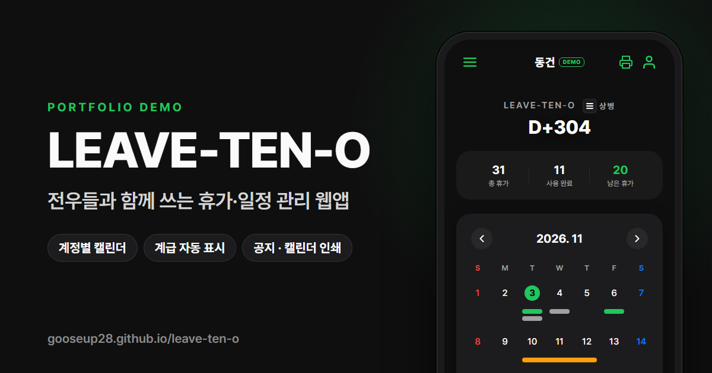

# LEAVE-TEN-O 데모

[DAY-TEN-O](https://github.com/gooseup28/day-ten-o)를 같이 쓰고 싶다는 전우들을 위해, 각자 계정을 만들어 쓸 수 있게 확장한 휴가·일정 관리 웹앱 **LEAVE-TEN-O**의 포트폴리오용 데모입니다.

**데모: https://gooseup28.github.io/leave-ten-o/**

- 계정별 캘린더: 이름·입대일·4자리 암호로 계정을 만들고, 휴가·일정·메모는 계정마다 따로 저장
- 계급 자동 표시: 입대일로 이병·일병·상병·병장 배지와 전역 D-Day·복무율·남은 일과일 계산
- 기본 캘린더와 공지: 모두가 함께 보는 공용 캘린더, 관리자만 공지를 쓰고 지울 수 있음
- 캘린더 인쇄: 원하는 달 범위를 골라 종이 달력으로 인쇄
- 그 밖에: 연가·포상·위로 휴가 관리, 공휴일·대체공휴일 자동 표시, 밀어서 수정·삭제, 다크 모드·테마 색

## 데모에 대해

- 서버 없이 동작합니다. 데이터는 방문자 브라우저(localStorage)에만 저장됩니다.
- 샘플 계정 동건(상병)·민준(일병)·지훈(병장)과 기본 캘린더 공지가 오늘 날짜 기준으로 채워집니다. 계정 암호와 관리자 암호는 모두 `0000`입니다.
- 원본 앱은 Supabase로 실시간 동기화하고, 이 데모에서는 서버 연결·브라우저 알림·영어 전환(번역 미완성)만 뺐습니다.

## 파일 구성

| 파일 | 역할 |
| --- | --- |
| `index.html` | PC용 소개 페이지 (휴대폰 틀 안에 앱 표시). 휴대폰에서는 `app.html`로 바로 이동 |
| `app.html` | 앱 본체 (HTML · CSS · Vanilla JS) |
| `demo.js` | Supabase 클라이언트와 같은 모양으로 동작하는 브라우저 저장소 DB + 샘플 계정 |
| `og-image.png` | 링크 미리보기용 대표 이미지 (1200×630) |
